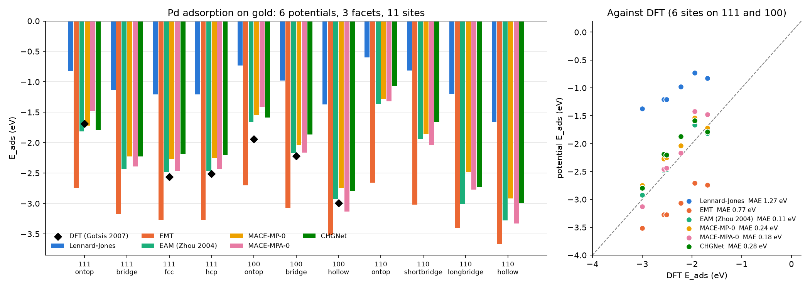
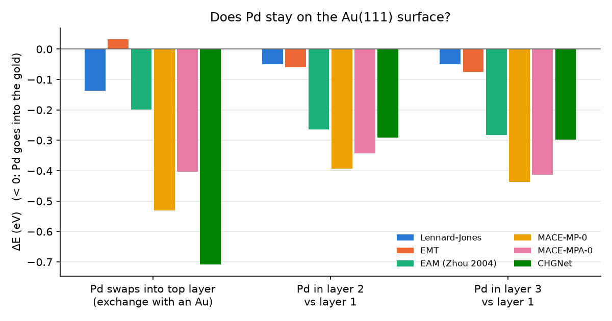

# Pd adsorption on gold surfaces: a ladder of interatomic potentials (ASE)

Gold is the detector surface in single-atom thermochromatography of superheavy elements at FLNR (JINR, Dubna).
Palladium is the lighter homolog of **darmstadtium (Ds, Z = 110)**. This repository screens Pd adsorption on
**all 11 high-symmetry sites of Au(111), Au(100) and Au(110)** with **six interatomic potentials**, from a pair
potential to machine-learned universal potentials, and checks them against DFT. It also tests whether a Pd atom
stays on the surface at all.

It starts from the baseline ASE demos in
[`miroi/open-collection`](https://github.com/miroi/open-collection/tree/master/theoretical_chemistry/projects/adsorptions_with_ase)
(`Pt_on_gold`). Everything was run in a Linux terminal (WSL2 Ubuntu) on a laptop CPU.



## Key findings
1. **The choice of potential changes E_ads more than the choice of site.** On Au(111) fcc the six potentials span
   −1.20 to −3.27 eV. The DFT reference is −2.56 eV (Gotsis *et al.* 2007).
2. **The EAM alloy potential is the most accurate model here.** Zhou–Johnson–Wadley EAM comes within 0.11 eV of DFT
   on average (6 sites). It reproduces the DFT site order fcc < hcp < ontop on Au(111) and the stronger binding on
   Au(100). MACE-MPA-0 follows (0.18 eV), then MACE-MP-0 (0.24) and CHGNet (0.28). All three MLIPs underbind slightly.
3. **EMT overbinds by about 0.7 eV, and Lennard-Jones underbinds by half.** This holds even with literature LJ metal
   parameters (Heinz 2008). A pair potential has no many-body (embedding) term, so it cannot describe metal–metal
   bonding at an undercoordinated adatom.
4. **CHGNet gets the Au(111) site order wrong.** It puts the bridge (−2.22 eV) below the fcc hollow (−2.19 eV). DFT
   and the other five potentials prefer the hollow.
5. **Open facets bind Pd more strongly:** Au(111) < Au(100) < Au(110) hollow for every potential. Binding grows with
   the number of Au neighbours.
6. **Pd does not stay on top of Au(111).** Five of the six potentials find that Pd swapping into the top layer
   (pushing an Au atom out) is downhill, by 0.14–0.71 eV. All six find that Pd prefers to sit below the surface
   (layer 2 or 3 vs layer 1). This agrees with the known surface segregation of Au in Au–Pd alloys. EMT is the
   only potential that keeps the adatom on top. For a detector this means a group-10 atom may alloy into the gold
   rather than physisorb or chemisorb reversibly, and a single "adsorption energy" may not describe its deposition.
7. **The baseline "relaxed" demo double-counts surface relaxation.** `Pt_on_Au-slab_relaxed_EMT.py` relaxes the
   slab + adatom but subtracts the unrelaxed clean slab. Its extra −0.42 eV (Pd: −3.71 vs −3.29 eV) is almost all
   the clean slab's own relaxation (−0.435 eV). With consistent references the two demos agree.



## Results: E_ads (eV)
| Facet | Site | LJ | EMT | EAM | MACE-MP-0 | MACE-MPA-0 | CHGNet | DFT* |
|---|---|--:|--:|--:|--:|--:|--:|--:|
| Au(111) | ontop | −0.82 | −2.74 | −1.81 | −1.72 | −1.48 | −1.79 | −1.69 |
|  | bridge | −1.13 | −3.18 | −2.43 | −2.23 | −2.39 | −2.22 |  |
|  | fcc | −1.20 | −3.27 | −2.48 | −2.27 | −2.46 | −2.19 | −2.56 |
|  | hcp | −1.20 | −3.27 | −2.46 | −2.25 | −2.44 | −2.20 | −2.51 |
| Au(100) | ontop | −0.73 | −2.70 | −1.66 | −1.54 | −1.42 | −1.59 | −1.94 |
|  | bridge | −0.98 | −3.07 | −2.17 | −2.04 | −2.17 | −1.87 | −2.22 |
|  | hollow | −1.37 | −3.52 | −2.92 | −2.74 | −3.13 | −2.80 | −3.00 |
| Au(110) | ontop | −0.60 | −2.66 | −1.37 | −1.28 | −1.32 | −1.07 |  |
|  | short bridge | −0.81 | −3.02 | −1.93 | −1.86 | −2.03 | −1.66 |  |
|  | long bridge | −1.20 | −3.40 | −3.00 | −2.48 | −2.77 | −2.73 |  |
|  | hollow | −1.67 | −3.67 | −3.28 | −2.92 | −3.33 | −3.00 |  |
| **MAE vs DFT** | | 1.27 | 0.77 | **0.11** | 0.24 | 0.18 | 0.28 | |
| a₀ of Au (Å), exp. 4.078 | | 4.061 | 4.056 | 4.080 | 4.175 | 4.166 | 4.169 | |
| Time for all 11 sites (4-core laptop) | | 13 s | 2 s | 17 s | 135 s | 158 s | 106 s | |

\*GGA-DFT, Gotsis *et al.*, *Chem. Phys. Lett.* **442**, 105 (2007). 1 eV = 96.485 kJ/mol.

### Does Pd go into the gold? Au(111), ΔE (eV), negative = yes
| | LJ | EMT | EAM | MACE-MP-0 | MACE-MPA-0 | CHGNet |
|---|--:|--:|--:|--:|--:|--:|
| Pd adatom → Pd in top layer + Au adatom | −0.14 | +0.03 | −0.20 | −0.53 | −0.40 | −0.71 |
| Pd in layer 2 vs layer 1 | −0.05 | −0.06 | −0.26 | −0.39 | −0.34 | −0.29 |
| Pd in layer 3 vs layer 1 | −0.05 | −0.08 | −0.28 | −0.44 | −0.41 | −0.30 |

## Method
E_ads = E(slab + Pd) − E(slab) − E(Pd atom), with all three terms from the same potential.
- **Potentials** (`potentials.py`): 12-6 Lennard-Jones with Heinz 2008 Au/Pd parameters and Lorentz–Berthelot
  mixing (a small custom ASE calculator, because ASE's `LennardJones` has a single σ/ε); ASE `EMT`; ASE `EAM` with
  the Zhou 2004 Au–Pd `eam.alloy` file; MACE-MP-0 (medium) and MACE-MPA-0 (medium) from mace-torch 0.3.16; CHGNet 0.4.2.
- Each potential uses its own Au lattice constant from an equation-of-state fit.
- Slabs: 3×3, 4 layers for (111)/(100) and 6 for (110), 12 Å vacuum. The bottom half is frozen and the rest is
  relaxed with BFGS to f_max = 0.02 eV/Å. **The clean slab is relaxed with the same constraints.**
- Pd is held laterally on its site (`FixCartesian`), so each energy belongs to its labelled site. Bridge energies
  are therefore an estimate of the hollow-to-hollow diffusion barrier, not minima.
- Alloying test (`pd_alloy.py`): 3×3×5 Au(111), bottom 2 layers frozen. The exchange and adatom configurations
  have identical composition (45 Au + 1 Pd); the depth profile compares one Pd in layer 1, 2 or 3 (44 Au + 1 Pd).

## Repository layout
```
demos/              the professor's two Pt_on_gold EMT scripts, switched to Pd
potentials.py       the six calculators
pd_production.py    11 sites on Au(111)/(100)/(110), one potential  ->  results_<pot>.csv
pd_alloy.py         exchange and subsurface test on Au(111)          ->  alloy_<pot>.csv
plot_pd.py          figures/Eads_ladder.png, figures/Pd_alloying.png, MAE table
AuPd.eam.alloy      Zhou 2004 EAM file, generated with LAMMPS tools/eam_database/create_eam.py
results/            CSV tables
structures/         relaxed geometries (.xyz, open with `ase gui`)
```

## Reproduce
```bash
python -m venv ase-env && source ase-env/bin/activate
pip install -r requirements.txt
# (optional) regenerate the EAM file
curl -sSLO https://raw.githubusercontent.com/lammps/lammps/develop/tools/eam_database/create_eam.py
curl -sSLO https://raw.githubusercontent.com/lammps/lammps/develop/tools/eam_database/eamDatabase.py
python create_eam.py -n Au Pd
for p in lj emt eam mace mpa chgnet; do python pd_production.py $p; python pd_alloy.py $p; done
mkdir -p results structures figures; mv results_*.csv alloy_*.csv results/; mv *.xyz structures/
python plot_pd.py
```

## Limitations and next steps
- The DFT reference is a single GGA study and covers only Au(111) and Au(100). The MLIPs are trained on PBE bulk
  data with few adsorbate configurations.
- 0 K static energies on ideal, unreconstructed surfaces. The real Au(111) herringbone and Au(110) missing-row
  reconstructions are not modelled. Experiment measures an enthalpy.
- The 3×3 cell puts the exchanged Au adatom close to the Pd. A larger cell and NEB barriers for the exchange
  would show whether it happens at detector temperatures.
- No spin–orbit coupling, which matters for Ds. Transfer to the superheavy element needs relativistic reference data.
- Next: NEB diffusion and exchange barriers, Au(211) steps, herringbone elbows, fine-tuning a MACE model on a
  few DFT Pd/Au points.

## References
- H. J. Gotsis, I. Rivalta, E. Sicilia, N. Russo, "Pd, Rh, Ir and Pt adsorption on gold: a theoretical study of
  different surfaces", *Chem. Phys. Lett.* **442**, 105 (2007).
- R. L. H. Freire, A. Kiejna, J. L. F. Da Silva, *J. Phys. Chem. C* **118**, 19051 (2014).
- X. W. Zhou, R. A. Johnson, H. N. G. Wadley, *Phys. Rev. B* **69**, 144113 (2004).
- H. Heinz, R. A. Vaia, B. L. Farmer, R. R. Naik, *J. Phys. Chem. C* **112**, 17281 (2008).
- A. H. Larsen *et al.*, "The atomic simulation environment", *J. Phys.: Condens. Matter* **29**, 273002 (2017).
- I. Batatia *et al.*, "A foundation model for atomistic materials chemistry" (MACE-MP-0), arXiv:2401.00096.
- B. Deng *et al.*, "CHGNet as a pretrained universal neural network potential", *Nat. Mach. Intell.* **5**, 1031 (2023).
- Baseline scripts: M. Iliaš, [`miroi/open-collection`](https://github.com/miroi/open-collection).

*Based on project 410 proposed by Dr. D. Sen and Dr. M. Iliaš for the INTEREST programme (JINR Dubna).*
